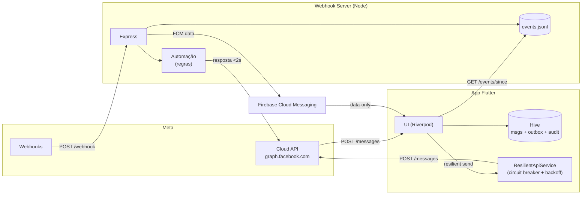

# WhatsApp Business Hub — Hub de Operações (Cloud API oficial)

App Flutter (Android 10+) para operar até **10 números de WhatsApp Business**
via **WhatsApp Business Cloud API (Meta)** — 100% oficial, sem clientes
não-oficiais, sem WebViews embutidos do WhatsApp Web.

> **Decisão de arquitetura:** este projeto **não** inclui fallback via
> `web.whatsapp.com`. Operar contas pelo WhatsApp Web dentro de um app
> terceiro viola os Termos de Uso do WhatsApp e causa banimento dos números.
> Todos os números precisam estar onboardados na Cloud API.

## Arquitetura

```
┌─────────────┐   webhook    ┌──────────────┐   FCM    ┌──────────────┐
│ Meta Cloud  │ ───────────▶ │ webhook_server│ ──────▶ │ App Flutter  │
│ API         │ ◀─────────── │ (Node.js)     │         │ (Hive cache) │
└─────────────┘  /messages   └──────────────┘         └──────────────┘
       ▲                            │ automação (<2s)
       └────────────────────────────┘
```

- **Recebimento:** Meta → `POST /webhook` → automação → FCM data-only → app persiste no Hive → inbox atualiza.
- **Envio:** app → `POST graph.facebook.com/v21.0/{phone-number-id}/messages`.
- **Histórico:** a Cloud API **não tem endpoint de listagem de conversas**; o inbox é construído dos eventos de webhook (cache local de 500 msgs/thread).

## Setup

### 1. Meta Developers
1. Crie um app em developers.facebook.com → adicione o produto **WhatsApp**.
2. Em **API Setup**, conecte os números (até 10) e anote cada `phone_number_id`.
3. Gere um token (System User → longa duração para produção).
4. Em **Configuration → Webhooks**, cadastre `https://SEU-SERVIDOR/webhook` com seu `VERIFY_TOKEN`.

### 2. Servidor de webhooks
```bash
cd server && npm install
VERIFY_TOKEN=segredo WA_TOKEN=seu_token FIREBASE_SA=./sa.json npm start
# Sincronize as regras de automação: POST /rules { rules: [...] }
```

### 3. App
```bash
flutter pub get
flutter run
```
Na tela **Configurações**: cole o access token (vai para o EncryptedSharedPreferences) e cadastre os números com seus `phone_number_id`.

Para push: adicione `google-services.json` em `android/app/` (Firebase). Sem ele, o app funciona em modo local.

## Build do APK assinado

```bash
# 1. Keystore de produção (uma vez)
keytool -genkey -v -keystore ~/bhub-release.keystore -alias bhub \
  -keyalg RSA -keysize 2048 -validity 10000

# 2. android/key.properties (NÃO commite)
storePassword=SUA_SENHA
keyPassword=SUA_SENHA
keyAlias=bhub
storeFile=/home/voce/bhub-release.keystore

# 3. Em android/app/build.gradle, aplique signingConfigs (padrão Flutter) e:
flutter build apk --release --shrink
```

O `R8`/`ProGuard` já vem ativo no template release do Flutter (`minifyEnabled`).

## Estrutura

```
lib/
  core/        # config + models (PhoneNumber, ChatMessage, Conversation, AutomationRule)
  services/    # auth (secure storage), api_service (Cloud API), cache (Hive), notifications
  state/       # Riverpod: números, inbox unificado, filtro, automações, canned responses
  features/
    dashboard/ # grid de cards por número + métricas locais
    inbox/     # inbox unificado + conversa nativa (bolhas, composer c/ {{nome}})
    automation/# editor de regras (executadas no backend)
    settings/  # token + números + data masking
server/        # webhook + automação + FCM (Node.js)
android/       # manifest + MainActivity (FLAG_SECURE opcional)
```

## Limites honestos

- Sem webhook público, não há recebimento em tempo real (o app não pode receber callbacks da Meta diretamente).
- Templates precisam de aprovação prévia na Meta para primeiro contato / fora da janela de 24h.
- Métricas do dashboard (% leitura etc.) são calculadas do cache local de eventos.
- **Sem typing indicator via webhook:** a Cloud API não emite eventos de "digitando" — não implementamos indicador falso.
- **Sem endpoint de histórico na Meta:** a reconciliação (`StateSyncService`) usa o log de eventos do *seu* webhook server (`GET /events/since`), não a Meta.

## Arquitetura (fluxo de dados)



## Troubleshooting

| Sintoma | Causa provável | Solução |
|---|---|---|
| Webhook não recebido | URL sem HTTPS pública ou verify token divergente | Confira `VERIFY_TOKEN` no `.env` e o callback URL no painel Meta; teste `GET /webhook?hub.mode=subscribe...` manualmente |
| Token expirado (`#190`) | Token temporário (24h) | Gere token de System User (60 dias) ou implemente `POST /token/refresh` no servidor; o app avisa 7 dias antes |
| FCM não chega | `google-services.json` ausente ou tópico não inscrito | Adicione o arquivo em `android/app/`; inscreva o app no tópico `wa_<phone_number_id>` |
| Mensagem presa no outbox | Sem rede ou circuit breaker aberto | Verifique conectividade; o reenvio é automático ao voltar a rede; toque no ícone ↻ para forçar |
| Inbox vazio após instalar | Nenhum webhook recebido ainda | O inbox nasce dos eventos — envie uma mensagem de teste pelo onboarding |
| Build falha no `flutter analyze` | Lints estritos (`analysis_options.yaml`) | Rode `dart fix --apply` e revise os warnings restantes |

## Testes

```bash
flutter test --coverage   # unit + widget (mocktail, sem codegen)
```
Cobertura alvo: > 80% dos services. O teste de integração (`integration_test/`) é um scaffold que exige credenciais de staging via `--dart-define`.
